# How the app fits together

This page is a map of the app.
It shows the main areas of the screen, how you get to each one, and what happens step by step for the common tasks.
If you want the details on any one piece, follow the links.

## UI map

Everything lives on one page.
The header holds the project name, the menus, Share, and the status pills.
Below it are the Files panel, the editor, and the preview.
The footer shows diagnostics.
Dialogs open on top of all of that.

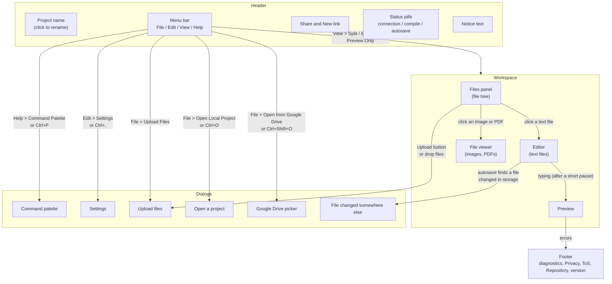

Where to read more about each area:

- Header and menus: [Interface and layout](interface-layout.md).
- Files panel and viewer: [Projects and files](projects.md).
- Editor, preview, and footer: [Editing and preview](editing-and-preview.md).
- Share and the connection pill: [Sharing and collaboration](collaboration.md).
- Autosave pill and Drive: [Saving and storage](saving-and-storage.md).

## User flows

### Starting a new document or project

A new tab gives you a starter project with one `main.tex`.
It isn't saved until it has a name.
New Project is host only, and its confirm warns that it clears the project for everyone in the room.

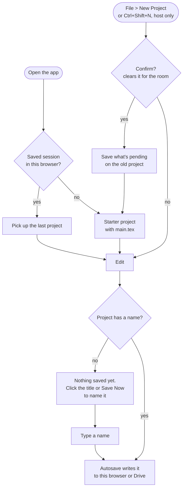

### Sharing a room and someone joining

The host clicks Share, sends the link, and the guest opens it.
Both browsers find each other through public trackers, then connect directly over WebRTC.

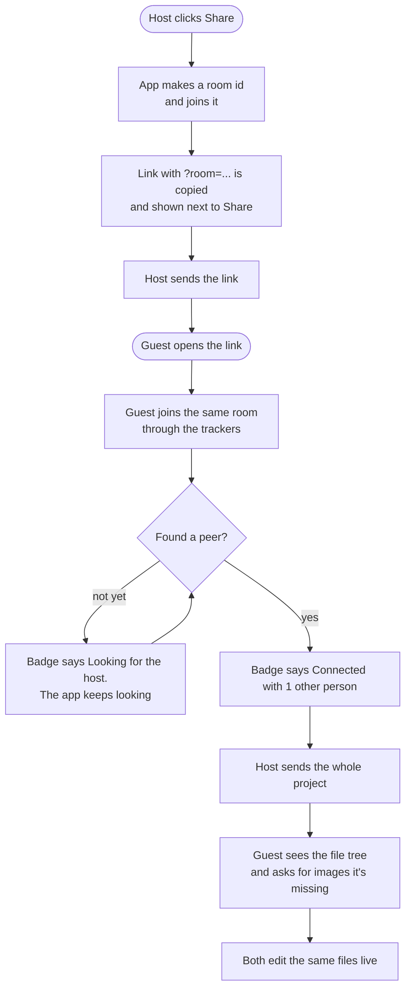

### Connecting Google Drive and saving

Drive only works if the site was set up with Google keys.
Sign-in happens in a popup, so allow popups for the site.

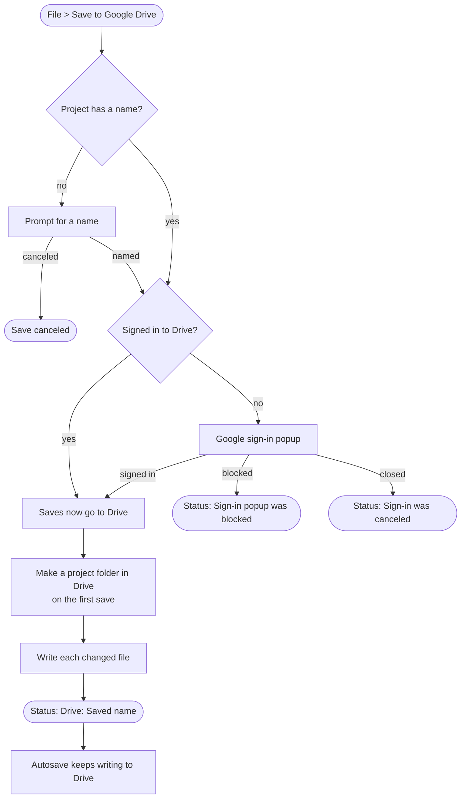

**File > Connect Google Drive** does the same sign-in, then switches autosave over to Drive without saving right away.
**File > Disconnect Google Drive** signs out, revokes the token, and sends saves back to this browser.

If a save finds that a file changed in Drive since the app last saved it, the app doesn't overwrite it.
Saving pauses for that file, and the conflict dialog asks you to pick **Keep mine**, **Take theirs**, or **Save mine as a copy**.
See [When a file changed somewhere else](saving-and-storage.md#when-a-file-changed-somewhere-else).

### Opening a project

You can open a project from this browser, from Drive, or from a `.zip`.

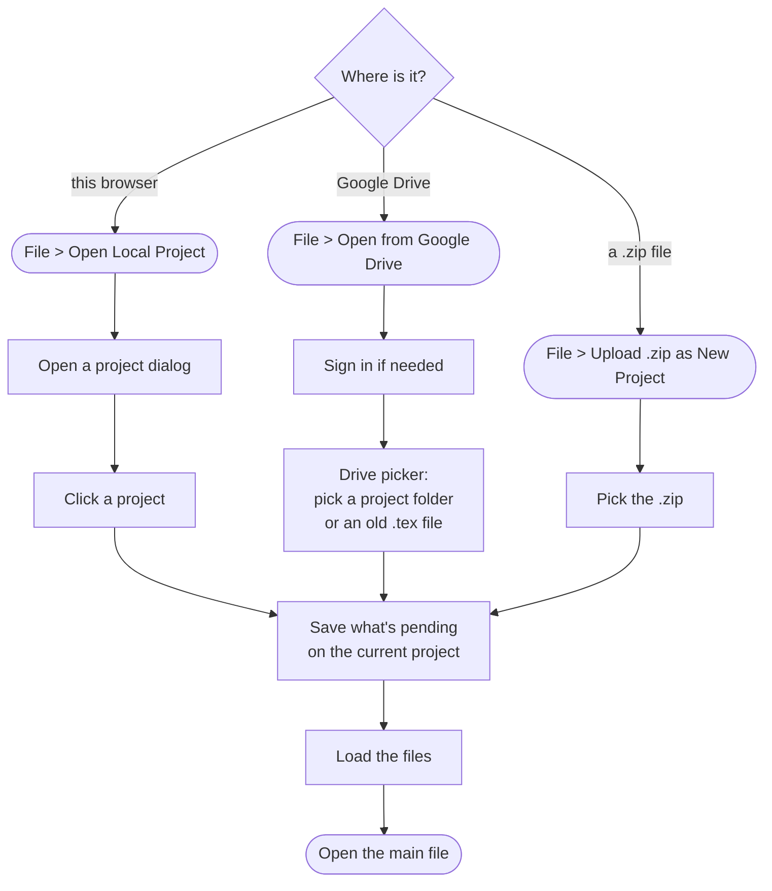

### Uploading an image

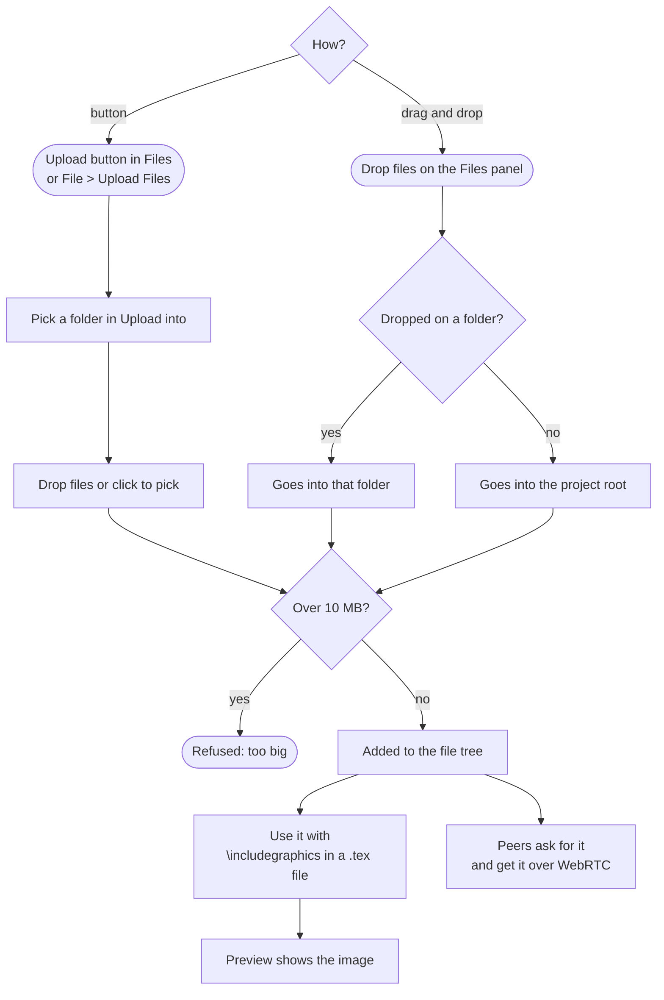

### Fixing a compile error

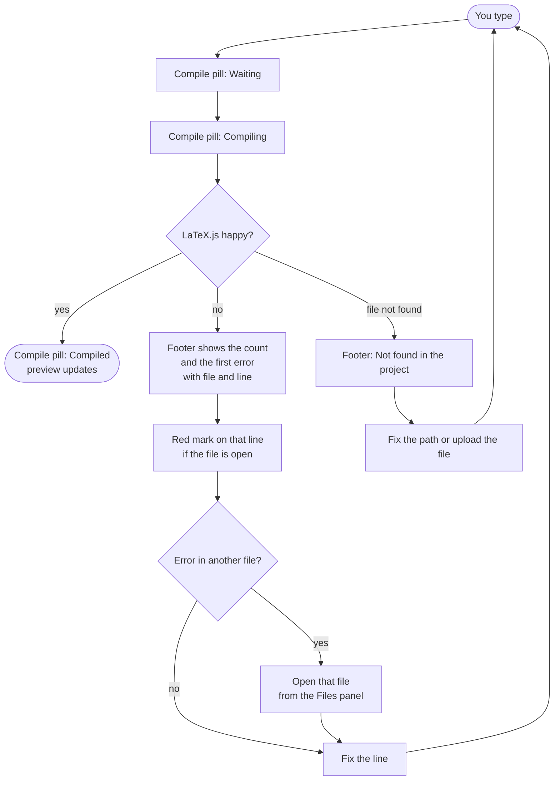

## State diagrams

### Autosave on and off

Autosave turns on for the host once browser storage is ready.
It only writes a project that has a name.
A file that changed in storage since the last save is held back until you answer the conflict dialog, while the other files keep saving.
Guests never save, the host does.
**Pause Saving** stops autosave and **Save Now** until you turn it off.
What changed in the meantime saves as soon as you resume.

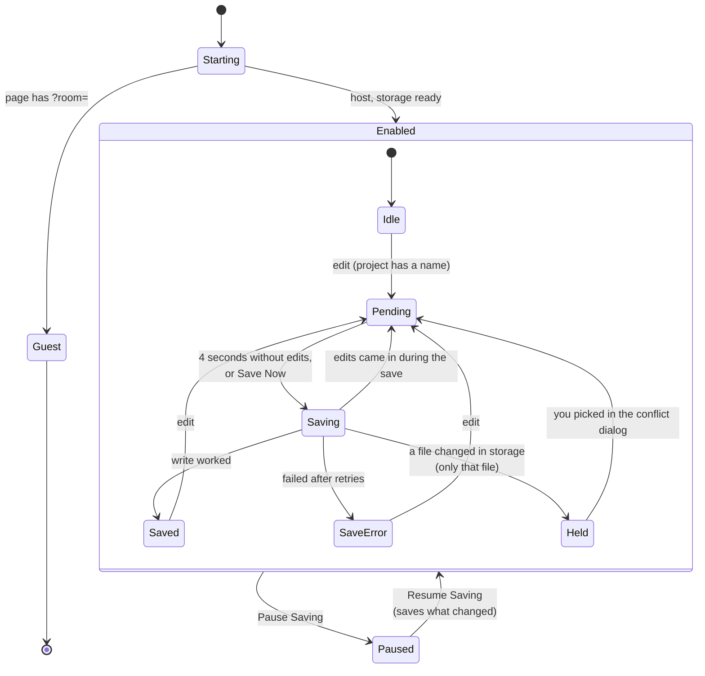

The pill text for each state is in [Status and error messages](messages.md#autosave-pill).

### Google Drive connected and expired

The Drive sign-in lives in the tab's `sessionStorage`.
A reload in the same tab keeps it, but a new tab or a restarted browser starts signed out.

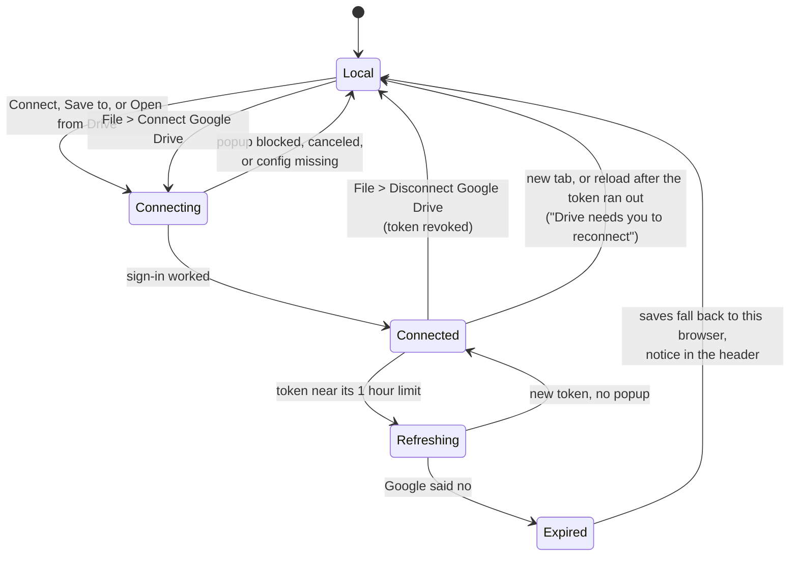

### Host and guest

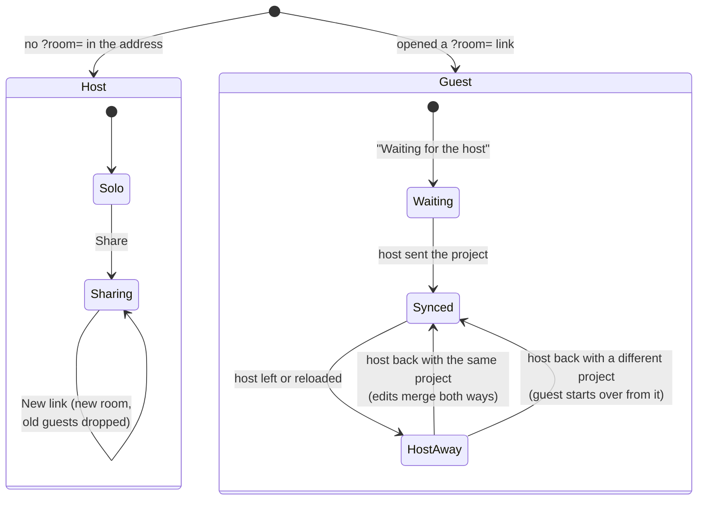

While the host is away, a guest keeps its copy and can keep typing.
Those edits reach the host when it comes back, as long as the host is still on the same project.

### Peer connection

These are the connection states behind the badge.
The badge says them in plainer words, like "Shared, waiting for others" or "Can't reach the host". See [Connection status](collaboration.md#connection-status).

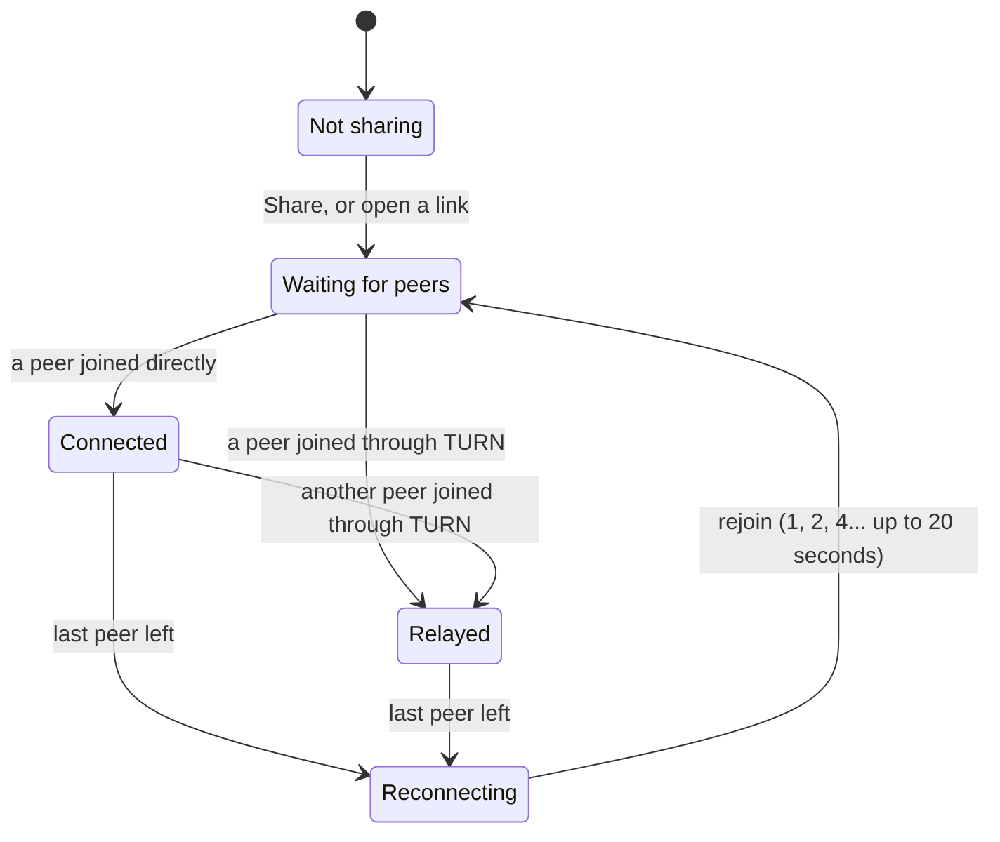

Waiting for peers has no timeout, since nobody joining yet is normal.
Relayed means the connection really goes through a TURN server, which the app checks with `getStats()` when a peer joins.
