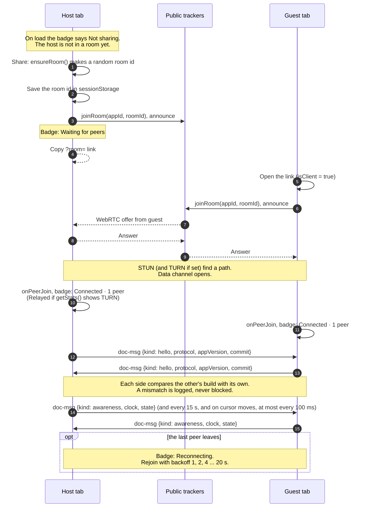
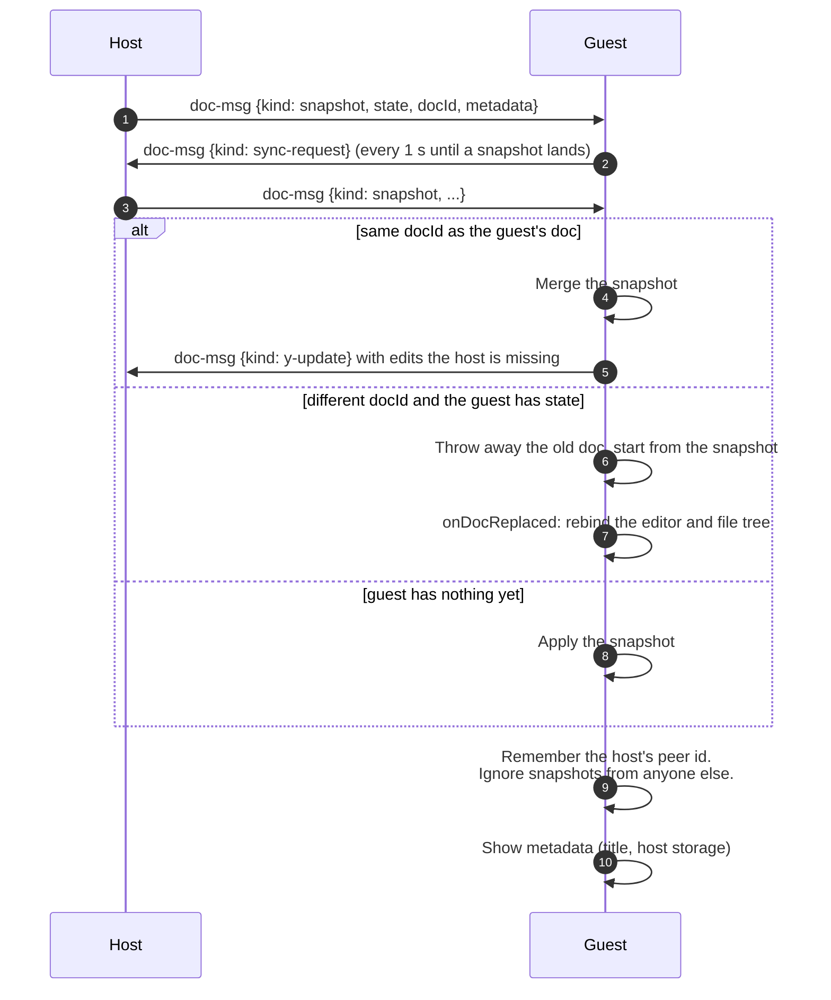
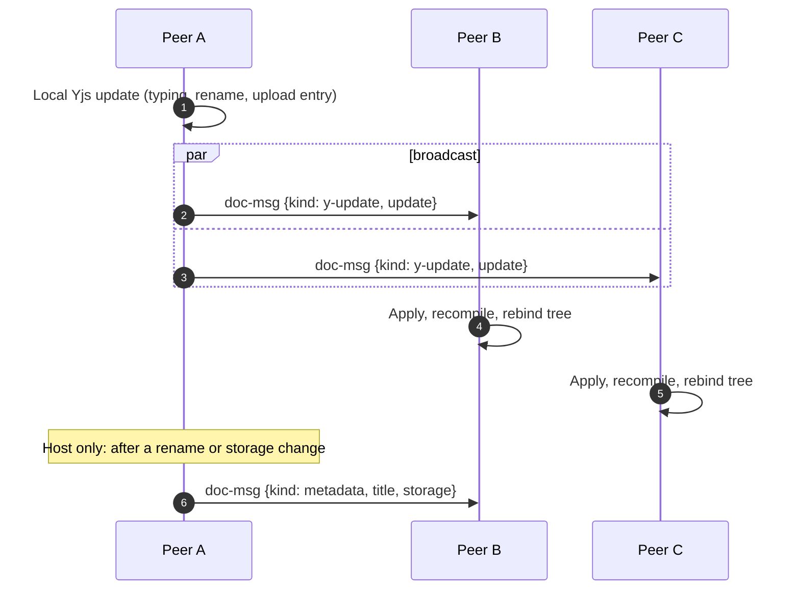
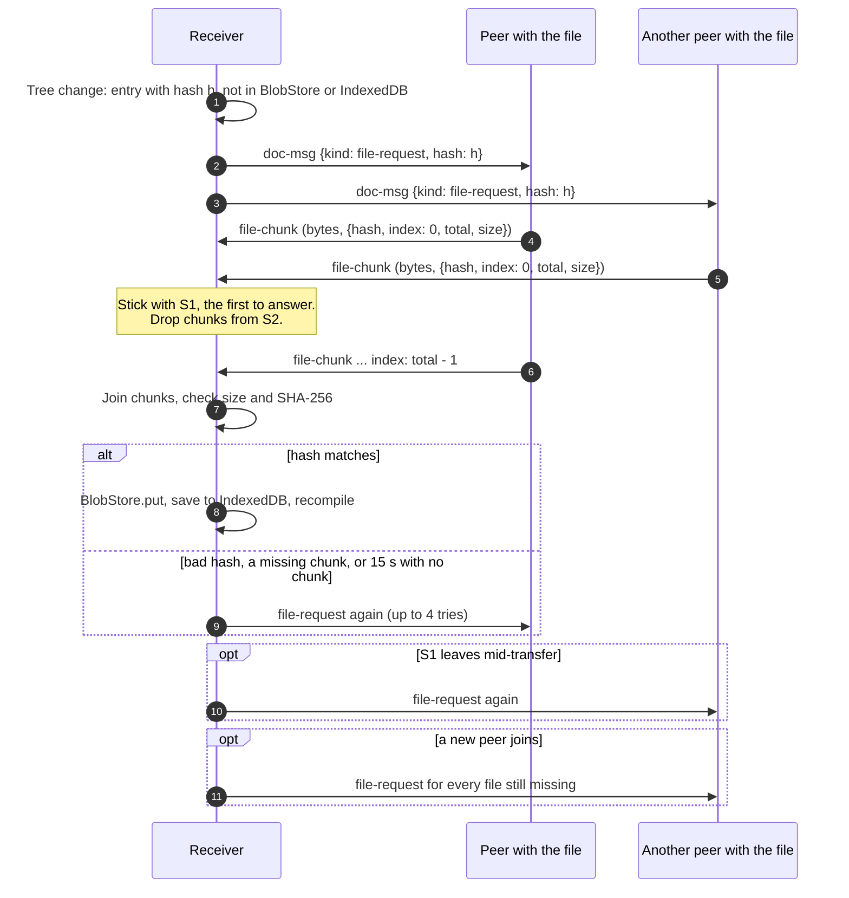

# Serverless P2P Protocol

Overview
- This document describes the client-side, serverless peer-to-peer protocol used by the editor. It emphasizes privacy (document bodies stay peer-to-peer) and reliability (public rendezvous endpoints help peers bootstrap without a central signaling server).

Rendezvous and session bootstrap
- Session links include a room identifier, e.g. ?room=<id>.
- Peers join the same P2P topic/room via public rendezvous/bootstrap endpoints.
- Those endpoints are WebTorrent trackers, used through Trystero's torrent strategy.
  The list comes from `VITE_P2P_RENDEZVOUS` and is passed to Trystero as `relayConfig.urls`, so Trystero never falls back to its own relay list.
  The page's Content Security Policy only lets it open WebSockets to these trackers. The build adds any custom `VITE_P2P_RENDEZVOUS` trackers to `connect-src` (see `docs/deployment.md`).
- Trackers only see the hashed room topic and WebRTC offers and answers, never document content.
- No repository-owned signaling server is required.
- The host's room id is kept in the tab's sessionStorage after Share, so reloading the host tab rejoins the same room and guest links keep working.
- The room id is stored apart from the saved document, since it's rendezvous metadata and not content.
- The host can click New link to leave the current room and start a fresh one, which disconnects anyone on the old link.

Transport behavior
- The app uses a transport layer over a third-party rendezvous infrastructure (WebRTC-like semantics).
- ICE configuration starts with STUN, with optional TURN fallback for restricted NATs.
  TURN credentials are built into the static bundle, so they're public; use short-lived ones (see `docs/deployment.md`).
- UI surfaces connection states, with the number of connected peers next to them:
  - Not sharing: not in a room.
  - Waiting for peers: in a room, nobody else has joined yet.
    There is no timeout to a failed state.
  - Connected: at least one peer is connected and none go through TURN.
  - Relayed: at least one peer's selected ICE candidate pair uses a relay (TURN) candidate, checked with `RTCPeerConnection.getStats()` when the peer joins.
  - Reconnecting: the last peer left, so the app rejoins the room with backoff.

Version handshake
- When a peer joins, each side sends it `{ kind: 'hello', protocol, appVersion, commit }` on the document channel.
  - `protocol` is `PROTOCOL_VERSION` from `frontend/src/collab/messages.ts`, now `2`. It changes only when older peers can't handle the new messages.
  - Protocol `2` came with the move to Trystero 0.26. Trystero 0.25 changed how actions are framed on the data channel, so a peer on protocol `1` (Trystero 0.24) and a peer on `2` can connect through the trackers but can't read each other's messages, not even `hello`. They don't sync until both reload. Each tab's update prompt notices the new `version.json` on its own, so it doesn't need the hello for that.
  - `appVersion` is the app's SemVer version, like `0.1.0`, and `commit` is the short commit SHA of the build (or `dev`).
- Each peer compares the hello with its own build: `same-build`, `different-build` (same protocol, another version or commit), or `incompatible-protocol`.
  - It logs anything but `same-build` to the console. `incompatible-protocol` is a warning that says to reload.
  - It never blocks or disconnects the peer. The update prompt listens to `onPeerVersion`: when the peer's protocol is newer, this side shows the "reload to update" card; when it's older, a notice asks to have the collaborator reload. `different-build` alone shows nothing. No extra message is sent.
- Backward compatible both ways:
  - Builds from before the handshake drop `hello` as an unknown kind (quietly, or with a dev-only `console.warn`) and sync as before.
  - A newer peer that never gets a hello from an old one just doesn't list it. Nothing waits on the hello.
- The hello only has version numbers, never document content, and it goes over WebRTC like every other message, not through the trackers.
- How the protocol version is bumped and migrated is in `docs/versioning.md`.

Presence (awareness)
- While sharing, each peer tells the room who it is and where its cursor is (issue #22), so others see avatars next to Share, a dot on the file in the tree, and a caret with a name label in the editor.
- It's `{ kind: 'awareness', clock, state }` on the same `doc-msg` action as everything else. `state` is `{ name, color, file, cursor, id, joined }`, or `null` when the peer stops sharing or closes the tab. Builds from #163 send no `id` or `joined`.
  - `name` is the display name from Settings (an anonymous animal name like "Curious Otter" until the person changes it).
  - `id` is a presence id: 16 random lowercase hex characters, made on the first share and kept in settings (`presenceId`), so a person keeps their colour across reloads. It says nothing about the person and is only used for colours.
  - `joined` is when the sender started sharing, in ms since 1970 by its own clock. It only orders people for colours.
  - `color` is one of eight fixed colours. Everyone works it out the same way (`assignColors` in `collab/presence.ts`):
    - Each person prefers the colour an FNV hash of their `id` picks. A peer from #163 (no `id`) prefers the colour it sends, which it hashes from its Trystero peer id.
    - People are put in order: peers without `id` first (they can't move, since they pick their own colour), then by `joined`, then by `id`, then by Trystero peer id (which settles two tabs of one browser, which share an `id`).
    - In that order, each person gets their preferred colour, or the next one in the palette nobody before them has. So whoever joined later moves off a colour that's taken. Colours only repeat past eight people.
    - The order only uses what every peer sends, so every screen that sees the same people shows the same colours. A peer sends the colour it works out for itself, which is what #163 builds show. When someone leaves, the people after them can get their preferred colour back. A sender's clock being off only changes the order, not whether screens agree.
  - `file` is the id of the file the peer has open (not its path), or `null`.
  - `cursor` is `{ anchor, head }`, two Yjs relative positions as JSON (`{ tname, item?, assoc? }`), so the cursor stays on the same character while others type.
  - `clock` goes up with every message. A receiver ignores a clock that isn't newer than the last one from that peer.
- Nothing else is shared: no email, account, storage or browser details.
- Sending:
  - At most one message every 100 ms. Changes in between are folded into the next one.
  - A heartbeat every 15 s, even when nothing changed, and one straight to each peer that joins or that we hear from for the first time (its presence may have loaded after our join-time message reached it).
  - `state: null` on `pagehide`.
  - Never more than 1 KB as JSON. Every field has a cap, so a valid message is well under it.
- Receiving:
  - Each peer gets a token bucket of 30 messages, refilled at 15 a second. Messages over that are dropped.
  - A peer's presence is cleared when Trystero reports it left, when it sends `state: null`, or after 30 s with no message (the same timeout as y-protocols' awareness).
- `frontend/src/collab/awareness.ts` is a small stand-in for y-protocols' `Awareness`: the local state, the remote states and a `change` event, which is all y-codemirror.next's `yRemoteSelections` needs. It's lighter than adding `y-protocols`, and its messages are JSON we can check field by field instead of a binary update with JSON inside.
- The sending, checks and the avatar row (`collab/presence.ts`, `ui/presenceBar.ts`) load with sharing, not in the initial bundle.
- Compatibility, and why `PROTOCOL_VERSION` stays `2`:
  - Builds from before presence drop `awareness` as an unknown kind on `doc-msg`, like they dropped `hello` (see "Version handshake"), and keep syncing. This build doesn't need presence from anyone either: a peer that never sends it just isn't in the avatars.
  - So older peers can handle it, and per `docs/versioning.md` that's not a bump.
  - It deliberately doesn't use a new Trystero action. Trystero 0.26 doesn't drop data for an action name it has no handler for: it queues it, in case a handler is registered later, for up to 2 minutes and 64 messages per peer. With a presence stream on a new action, an old peer's queue would fill in seconds, and Trystero would then refuse that peer's large transfers on every action ("too many pending transfers"), snapshots included. Unknown kinds on `doc-msg` are delivered and dropped by our own check instead.

Document payload channel
- Document updates are exchanged peer-to-peer as action payloads.
- Rendezvous metadata does not carry document bodies.
- LaTeX source text remains entirely within peer-to-peer update messages.
- The host sends a full Yjs snapshot to each guest that joins, tagged with a doc id.
- The host saves its Yjs state and doc id with the local app session, so a reload resumes the same doc instead of starting a new one.
- This saved state lives in browser storage only and never goes into rendezvous metadata.
- Exports (File > Export…) add no messages. A file saved to Google Drive goes from the host's browser to the host's own Drive; guests can only download, and nothing about an export is sent to peers.
- A guest only accepts snapshots from the peer that is the host, and picks up the new host after the old one leaves.
- If the snapshot has the guest's doc id, the guest merges it and sends back any edits the host is missing.
- If the doc id is different, the guest throws away its doc and starts over from the snapshot, so its updates never point at items the host doesn't have.

Project sync
- A share link shares the whole project, not one file.
- The Yjs doc holds the project:
  - `files` is a Y.Map from a stable file id to its path and kind (text, binary, or folder). Binary entries carry a SHA-256 content hash and size.
  - Each text file has its own top-level Y.Text named `file:<id>`.
  - `meta` holds the project name and the main file id.
- A rename or move writes one key in `files`, so ids (and open editors) survive it.
- Two renames of the same file at once settle on one of the names, the same on every peer.
- A rename and a delete of the same file at once keep the renamed file, so no work is lost.
- Two peers making the same path at once both keep their files. The one with the later id shows up as "name (2).ext" on every peer.
- A folder move is one change per file inside it. A file a peer adds to the old folder at the same moment stays under the old path.
- Docs from before projects (one Y.Text called `doc`) become a one-file project on the host. The text stays where it was, so old room links and saved sessions keep working.

File transfer
- Binary files (images, PDFs and so on) are not stored in the Yjs doc. Only their hash is.
- A peer missing a file sends `{ kind: 'file-request', hash }` on the document channel.
- Any peer that has it answers with binary chunks on a separate `file-chunk` action, each tagged with `{ hash, index, total, size }`.
- Chunks are 64 KB. The receiver sticks with the first peer that answers, shows progress, and checks the hash before keeping the file.
- If the sender stalls or leaves, the receiver asks again (a few tries, then it gives up).
- Files over 10 MB are not sent or accepted.
- File bytes only travel between peers over WebRTC, the same as document text. Nothing is uploaded to a server.
- Peers keep files they've seen in IndexedDB by hash, so a reload doesn't have to ask again.

Templates and the profile (#74)
- Nothing about templates goes over the wire. A project made from a template is an ordinary project, sent the same way as any other; the template, its `template.json` and the template list stay in the creator's storage.
- The profile (name, affiliation, email, ORCID, address) is never sent to peers. It only reaches a room as text that a template already put into a project the host created. The only thing about a person a room gets is the separate display name in presence (above).

Message validation and limits
- Anyone with the room link can join and send anything, so every incoming message is checked before it's used.
- The checks live in `frontend/src/collab/messages.ts`. They're small hand-written type checks, not a schema library.
- Bad messages are dropped quietly. In dev builds they also log a `console.warn` saying why.
- Messages on the document channel:
  - `{ kind: 'y-update', update }`: `update` is an array of bytes (integers 0 to 255), at most 10 MB, and it has to decode as a Yjs update.
  - `{ kind: 'snapshot', state, docId?, metadata? }`: `state` is a byte array of at most 20 MB that decodes as a Yjs update. `docId` is a string of at most 128 characters.
  - `{ kind: 'metadata', metadata }`: `metadata` is `{ title, storage }`. The title is at most 200 characters and the storage label at most 200.
  - `{ kind: 'sync-request' }`: no other fields.
  - `{ kind: 'file-request', hash }`: `hash` is 1 to 128 letters, digits, or dashes.
  - `{ kind: 'hello', protocol, appVersion, commit? }`: `protocol` is a whole number from 1 to 1,000,000. `appVersion` is 1 to 64 letters, digits, dots, pluses, or dashes. `commit` is 7 to 40 lowercase hex characters, or `dev`.
  - `{ kind: 'awareness', clock, state }`, checked in `frontend/src/collab/presence.ts` (`parseAwarenessMessage`) after the rate limit above:
    - `clock` is a whole number, 0 or more. `state` is `null` or an object with exactly these fields:
    - `name`: 1 to 40 characters, already trimmed, single-spaced, with no control characters, line separators or bidi overrides (the same cleaning as the setting, `cleanDisplayName`).
    - `color`: exactly one of the eight palette colours, lowercase `#rrggbb`. It goes into a `style` attribute, so nothing else is accepted. For a peer that sends `id`, the receiver shows the colour it works out itself (see above).
    - `id` and `joined`: both or neither. `id` is exactly 16 lowercase hex characters (`/^[0-9a-f]{16}$/`); `joined` is a whole number, 0 or more.
    - `file`: `null`, or 1 to 64 letters, digits or dashes.
    - `cursor`: `null`, or `{ anchor, head }` when `file` is set. Each position has `tname`, which must be the open file's Y.Text name (`file:<file>`, or `doc` for a project from before multi-file), an optional `item` `{ client, clock }` (client 0 to 2^32 - 1, clock a safe whole number), and an optional `assoc` of -1, 0 or 1. A position with a nested type id (`type`) is dropped.
    - Before a cursor is used, the receiver checks that its doc already has a root type named `tname`, since resolving a position with an unknown name would create one. If not, the peer is shown without a cursor.
    - The name is only ever set as text (never HTML), in the avatar, the tooltip, the file tree label and the editor's name label.
  - Anything else, or anything with the wrong types, is dropped. Fields we don't know about are stripped.
- File chunks on the `file-chunk` action:
  - The data is binary and at most 256 KB per chunk. Trystero 0.26 hands it over as a `Uint8Array`; `parseChunk` also takes an `ArrayBuffer`.
  - `size` is at most 10 MB, `total` is between 1 and `size` (or 1 for an empty file), and `index` is below `total`.
  - The receiver stops a transfer and asks again once the chunks add up to more than `size`.
- Trystero 0.26 also caps each received action payload at 256 MiB (its default `maxReceiveBytes`) and refuses bigger transfers before they start. Our own limits above are far below that, so it never comes into play.
- At most 4 files come in at once. The rest wait in a queue and start as slots free up.
- At most 4 file requests are served at once, and a repeat request from the same peer for a file already going out is ignored. The peer asks again later.
- Host-only messages:
  - Only the host sends `snapshot` and `metadata`. The host ignores both if a guest sends them.
  - A guest takes the first snapshot as coming from the host, and from then on ignores snapshots from any other peer.
  - A guest ignores `metadata` unless it comes from that host. Metadata from before the first snapshot is ignored, since the snapshot carries it anyway.
  - Only the host answers `sync-request`.
- File paths in the shared `files` map have to be clean relative paths: no `..`, no leading `/`, no backslashes, no drive letters like `C:`, and at most 512 characters.
  Entries a peer writes with a bad path or an unknown kind are skipped, so they never show up in the file tree, the preview, or a zip.
- The project name in `meta` is cut to 200 characters when shown.

LaTeX preview channel
- Preview rendering is performed locally in the browser using LaTeX.js.
- LaTeX.js runs in a Web Worker with a small built-in DOM, so typing doesn't freeze on big documents.
  A new compile kills a worker that's still busy with an old one.
  If the worker can't start, or the project uses the `picture` environment (it needs real layout), the compile runs on the main thread instead.
- The preview reads the whole project, starting at the main file. `\input` and `\include` files are inlined, `\includegraphics` images go in as data URLs, and `\bibliography` gets a simple numbered reference list built from the .bib files.
- PDF and EPS figures can't be shown by LaTeX.js, so the preview puts a note in their place.
- Assets (CSS/fonts/scripts) may be loaded from public CDNs; document LaTeX content is never sent to a server for preview.
- User settings (themes, layout, keybinds, see `frontend/src/state/settings.ts`) are never part of any peer message, with one exception: the display name and the random presence id go out in presence messages while you share. A room otherwise only shares the project; each person, host or guest, keeps their own settings in their browser.

## Sequence diagrams

These follow the code in `frontend/src/net/` and `frontend/src/collab/`.
GitHub renders them, and so does MkDocs if this page is ever published.

### Bootstrap

The transport is trystero 0.26 over WebTorrent trackers (`VITE_P2P_RENDEZVOUS`, or the defaults in `bootstrapConfig.ts`).
`P2pTransport` uses two actions, `doc-msg` (JSON) and `file-chunk` (binary). In 0.25 and later, `room.makeAction(name, { onMessage })` returns `{ send, onMessage }`, `send(data, { target, metadata })` returns a promise, `onPeerJoin`/`onPeerLeave` are properties you set, and `leave()` returns a promise. `room` is typed with trystero's `Room`, so a future change to that API fails `tsc`.
The trackers only carry WebRTC offers and answers for the room topic.
Document data starts after the data channel is open.
The room topic comes from the app id (`VITE_P2P_APP_ID`) and the room id, so only tabs with the same app id meet. A staging build always uses an app id with `staging` in it, so staging and production peers never meet, even with the same room link (`docs/deployment.md`, "Staging and production"). The wire protocol itself is the same on both.

### Initial sync

The host sends a snapshot when a peer joins.
The guest also sends `sync-request` every second until it gets one, in case the first snapshot was missed.

### Live edits

### Project file transfer

Binary files are not in the Yjs doc, only their hash.
A peer that sees a hash it has no bytes for asks the room.

Files over 10 MB are never sent, and a chunk header claiming more than that ends the transfer.
At most 4 files come in at once, and each side serves at most 4 requests at once.
Every message and chunk in these diagrams goes through the checks in "Message validation and limits" above before it's used.

Security and privacy notes
- All document payloads are exchanged directly between peers.
- Rendezvous metadata contains only routing/session information, not document content.
- Preview rendering happens locally within a sandboxed iframe when possible.
