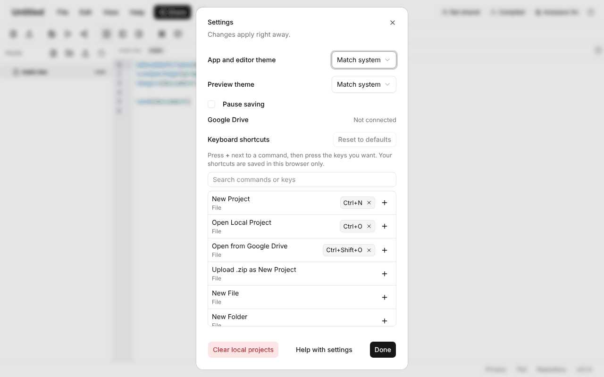
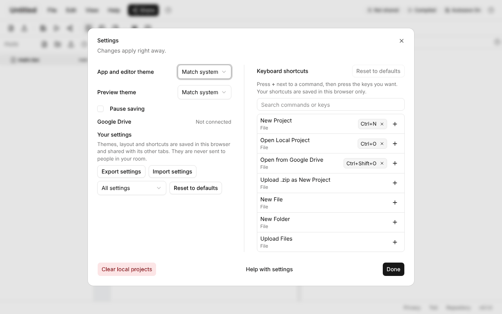
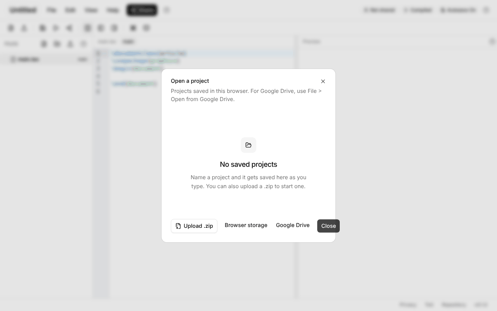
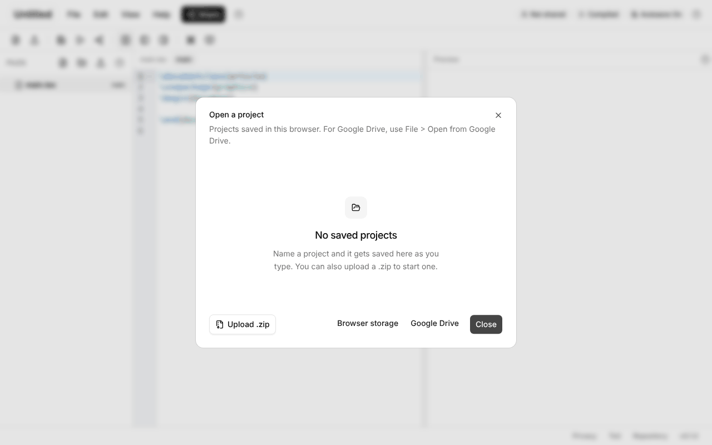
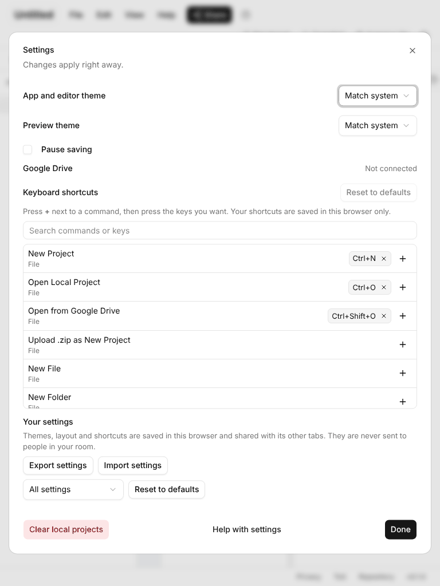
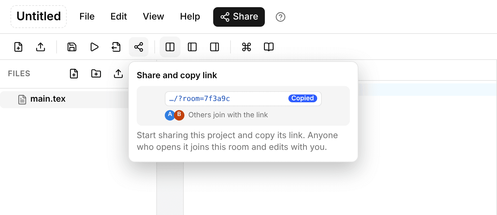
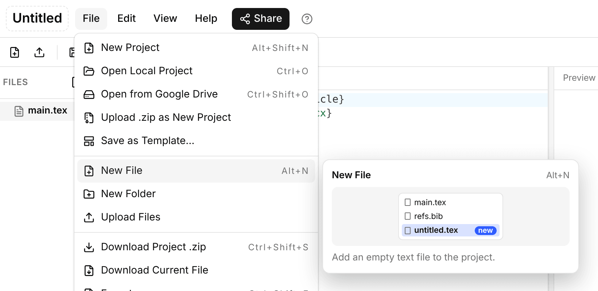
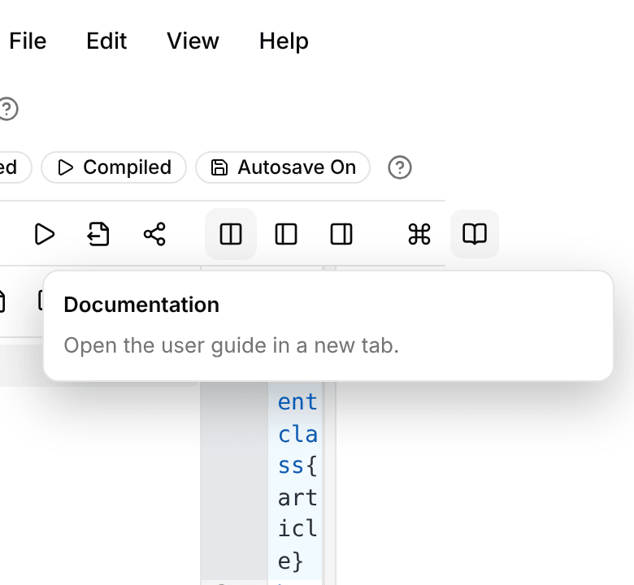

# UI sizing guide (internal)

How wide and tall dialogs, popovers and floating cards are, and how to pick a size for a new one.
This is a contributor reference. It isn't in the published user site (see `exclude_docs` in `mkdocs.yml`).
It came from issue #141, and it sets the rules the mobile work in issue #123 builds on.

The tokens and classes live at the top of the "Dialog and popover size scale" block in `frontend/src/style.css`.

## The size scale

Put one size class on the `<dialog class="dialog ...">` element. It sizes the box inside the dialog (Basecoat's `dialog > div`).

| Class | Token | Width | Use it for | Used by |
|-------|-------|-------|------------|---------|
| `dialog-sm` | `--dialog-sm` | 28rem (448px) | One question with one or two buttons: confirm, prompt, notice. | `confirmDialog`, `promptDialog` and `noticeDialog` in `frontend/src/ui/dialogs.ts` |
| `dialog-md` | `--dialog-md` | 36rem (576px) | Short forms, info, a short list, or three or more footer buttons. | Upload, Export, About, Open a project, Conflict |
| `dialog-lg` | `--dialog-lg` | 52rem (832px) | Dense content: long lists, sections side by side, long text to read. | Settings, What's new (changelog, #140) |
| `dialog-palette` | `--dialog-palette` | 40rem (640px) | The command palette. | `.command-palette` uses the token. The palette is a `div`, not a `<dialog>`. |

Floating UI that isn't a dialog uses two more tokens:

| Token | Width | Used by |
|-------|-------|---------|
| `--popover-card` | 22rem (352px) | The tour card, the update prompt, the preview-changes popover and the hover preview card (#89). |
| `--popover-menu` | 15rem minimum | The menu bar's dropdowns. They grow to fit their longest item. |

Every size is capped at `calc(100vw - var(--viewport-gutter))`. `--viewport-gutter` is 2rem, so there's 1rem on each side and nothing scrolls sideways.
The tour card and the update prompt use a 1.5rem gutter instead, because they sit 0.75rem (12px) from the window edge (see `margin` in `frontend/src/ui/tour.ts`). Each one has a comment saying so.

A dialog with no size class gets Basecoat's default (`sm:max-w-md`, which is 28rem), the same as `dialog-sm`. Still add the class, so the choice is written down. `frontend/src/test/dialogSizes.test.ts` fails if a dialog in `index.html` has no size class or more than one.

### Picking a size

1. Start with `dialog-sm` for anything that asks one thing.
2. Go to `dialog-md` when the dialog has a form with more than one field, a list, or three or more footer buttons. At 28rem, three or four footer buttons don't fit on one line (Open a project used to push its Close button past the edge).
3. Go to `dialog-lg` when the content is long enough that a 36rem box would scroll a lot, or has two parts that could sit side by side. Use the width: lay things out in columns (see Settings) instead of stretching single lines.
4. Don't add a new width. If none of these fits, change the scale here and in `style.css` together, and say why in the PR.

## Height and scrolling

- Basecoat caps the dialog box at the window height minus 2rem (`max-h-[calc(100%_-_2rem)]`).
- The box is a flex column: `header`, `section`, `footer`. The header and footer keep their size and the `section` scrolls (`.dialog > * > :where(section)` in `style.css`, kept at low specificity so a dialog's own body rule can override it). The footer buttons stay in view at any height.
- The section has `margin: 0 -0.25rem; padding: 0.125rem 0.25rem` so focus rings on its edges aren't clipped by the scroll box.
- Lists inside a dialog can have their own `max-height` when they'd otherwise push everything else out of view: the keybind list (18rem, 22rem in the wide Settings layout), the project list (50vh), the upload results (10rem), the palette list (48vh).
- At 640px and wider, dialog footers wrap instead of overflowing. Below that, Basecoat stacks them in a column.
- Popover cards set their own `max-height` when their content can grow (the preview-changes popover is `min(24rem, 60vh)`).

## Settings layout

Settings is `dialog-lg`. At 1024px (64rem) and wider its body is two columns:

- Left: themes, Pause saving, Google Drive, then "Your settings" (export, import, reset).
- Right: keyboard shortcuts, with a divider. It's the tall part, so it gets the slightly wider column (1.2fr).

The grid has five `auto` rows and a last `1fr` row that the shortcuts column spans. That last row takes the shortcuts column's extra height, so the left rows stay packed at the top.
Below 1024px it's one column, in the order of the markup.

## Spacing and type in use

These come from Basecoat's Vega style (`frontend/src/styles/basecoat-vega.css`) and `style.css`. Reuse them instead of new values.

- Dialog box: `1.5rem` padding, `1.5rem` gap between header, body and footer, `text-sm` (0.875rem), `rounded-xl`.
- Dialog header: `0.5rem` gap between title and description. Title is `font-medium` with `leading-none`.
- Dialog footer: `0.5rem` gap between buttons.
- Rows in a dialog body: `1rem` gap (`.settings-dialog-body`, `.upload-dialog-body`), `0.5rem` inside a group.
- Popover cards: `0.75rem` to `1rem` padding, `0.35rem` to `0.4rem` gap, `var(--radius-lg)` corners.
- Type: 0.875rem (14px) body, 0.8125rem (13px) hints and secondary text, 0.75rem (12px) captions, counts and footers, 1rem card titles.
- Radii: `var(--radius-sm)`, `var(--radius-md)` for inputs and chips, `var(--radius-lg)` for cards and popovers.

## Viewports and breakpoints

The breakpoints match Tailwind's defaults, which Basecoat already uses:

| Name | Width | Today | Planned in #123 |
|------|-------|-------|-----------------|
| Phone | under 640px (`sm`) | Every dialog is the window width minus 2rem. Footer buttons stack. | Dialogs become full-screen sheets (below). |
| Tablet | 640px to 1023px | Dialogs use the scale. `dialog-lg` is capped by the window, so Settings is one column. | Same as today. |
| Desktop | 1024px (`lg`) and up | The full scale. Settings is two columns. | Same as today. |

The smallest supported window is **360 x 640** (the smallest size in #123). At 768px wide nothing may scroll sideways.

### What each size does on phones (#123)

This PR doesn't build it, but this is the plan, so new dialogs shouldn't fight it:

- `dialog-sm`: stays a centered box, the window width minus 2rem. Confirm and prompt dialogs are short, so a sheet would be too much.
- `dialog-md`, `dialog-lg`: full-screen sheets below 640px. The box fills the window (`100dvw` by `100dvh`, no rounded corners), the header sticks to the top and the footer to the bottom, and the body scrolls. The rules above for header, body and footer already give this shape, so a sheet only changes the box size.
- `dialog-palette`: full width, pinned to the top, so the soft keyboard doesn't cover the list.
- Popover cards (`--popover-card`): full width minus the gutter, pinned to the bottom of the window. The tour card already shrinks to the window, but still covers part of each pane (#123).
- Menus (`--popover-menu`): today a dropdown can run past the right edge of a phone-width window, because it opens under its menu button. On phones the menu bar becomes one menu button (#123), and its menu should be a sheet or a full-width list.

### Touch targets

On touch screens (`@media (pointer: coarse)`), anything you can tap should be at least **44 x 44px**, including the space around it. Today's buttons are smaller (Basecoat's `sm` buttons are 32px, `icon-xs` 24px), which is fine with a mouse. #123 will raise them for coarse pointers. Don't make new controls smaller than the existing ones.

## How to check a change

Screenshot every dialog and popover you touched, at deviceScaleFactor 1, in these windows:

- 1920 x 1080 and 1280 x 800 (desktop)
- 1024 x 768 (the two-column Settings breakpoint)
- 768 x 1024 (tablet: nothing may scroll sideways)
- 390 x 844 (phone: must still fit, even before #123)

Build and serve the app (`npm run build && npx vite preview --port <port>` in `frontend/`) and drive it with Playwright. For each one, check:

- The box is the size this guide says, and stays 1rem inside the window.
- Nothing scrolls sideways: `document.documentElement.scrollWidth <= innerWidth`, and the box's own `scrollWidth <= clientWidth`.
- No text is cut off. Long file names wrap (the confirm and prompt dialogs use `overflow-wrap: anywhere`).
- When the window is short, the body scrolls and the footer stays in view.
- Light and dark themes both look right.

These screenshots are from #141, at 1280 x 800:

| Before | After |
|--------|-------|
|  |  |
|  |  |

Settings at 768 x 1024 is one column at the full `dialog-lg` cap: 

The hover preview card (#89) is `--popover-card` wide. It sits beside a menu (flipping to the left side at the window edge) or under a toolbar button, and stays 12px inside the window:

| Toolbar, 1280 x 800 | Menu, 1280 x 800 | 390 x 844 |
|---------------------|------------------|-----------|
|  |  |  |
